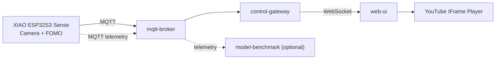

# RealTime-Face-Media-Control

> **현재 버전: A/B Mock Demo**
> - ✅ A: Firmware — Mock Detection(10초 true/false 교차) → MQTT (컴파일 검증, 실기기 미검증)
> - ✅ B: MQTT Broker(Mosquitto) + Control Gateway(FastAPI, WebSocket) — Docker 실행/통합 테스트 완료
> - ⏳ C: Web UI, D: Model Benchmark — 각 담당자 개발 중 (skeleton)
> - 이번 Demo는 **얼굴 존재 여부만** 판단합니다 (정면/측면 구분 없음, 실제 모델/카메라 미사용).

## Project Overview

Seeed Studio **XIAO ESP32S3 Sense**의 카메라와 **Edge Impulse Face Detection (FOMO)** 모델을 사용하여

- 사용자가 화면을 **정면으로 보고 있을 때** → YouTube 영상 **재생 (PLAY)**
- 얼굴이 검출되지 않거나 **측면/뒤쪽**을 바라볼 때 → 영상 **일시정지 (PAUSE)**

하는 실시간 스마트 미디어 제어 시스템입니다.

## System Architecture



자세한 내용: [`docs/architecture.md`](docs/architecture.md)

## Repository Structure

```
smart-youtube-face-control/
├── README.md
├── .gitignore
├── .env.example
├── docker-compose.yml
├── firmware/xiao-esp32s3-sense/   # Arduino firmware (not a container)
│   ├── smart_media/               # Arduino sketch (Mock detection, MQTT publisher)
│   └── include/  src/  models/  config/
├── services/
│   ├── mqtt-broker/               # Eclipse Mosquitto
│   ├── control-gateway/           # MQTT → State Machine → WebSocket
│   ├── web-ui/                    # YouTube IFrame API frontend
│   └── model-benchmark/           # Optional (profile: benchmark)
├── contracts/
│   ├── mqtt/                      # detection / status / telemetry schema
│   └── websocket/                 # media-control schema
├── docs/                          # architecture, communication, benchmark, test plan, roles
└── scripts/                       # mock_publisher.py, integration_test.py
```

## Docker Services

| Service | Base Image | Port | Profile | 상태 |
|---------|-----------|------|---------|------|
| `mqtt-broker` | `eclipse-mosquitto:2` | 1883 (9001 reserved) | default | **구현 (demo)** |
| `control-gateway` | `python:3.12-slim` + FastAPI | 8000 | default | **구현 (demo)** |
| `web-ui` | `nginx:1.27-alpine` | 8080 → 80 | default | 빈 static 서빙 |
| `model-benchmark` | `python:3.12-slim` (placeholder) | – | `benchmark` | placeholder (sleep) |

- Network: `smart-media-network`
- XIAO ESP32S3 Sense Firmware는 Docker Container가 아닙니다.

## Communication Flow

1. XIAO ESP32S3 Sense → (현재) Mock Detection / (향후) Camera + Edge Impulse
2. `raw_face_detected` true/false
3. MQTT publish → `smart-media/{device_id}/detection`
4. Mosquitto Broker → Control Gateway (subscribe)
5. Control Gateway 상태 판단 (true → PLAY, false/timeout/offline → PAUSE) → WebSocket `ws://<host>:8000/ws`
6. Web UI → YouTube IFrame API → PLAY / PAUSE

| Channel | Topic / Endpoint | Schema |
|---------|------------------|--------|
| MQTT | `smart-media/{device_id}/detection` | [`contracts/mqtt/detection.schema.json`](contracts/mqtt/detection.schema.json) |
| MQTT | `smart-media/{device_id}/status` | [`contracts/mqtt/status.schema.json`](contracts/mqtt/status.schema.json) |
| MQTT | `smart-media/{device_id}/telemetry` | [`contracts/mqtt/telemetry.schema.json`](contracts/mqtt/telemetry.schema.json) |
| WebSocket | Gateway → Browser | [`contracts/websocket/media-control.schema.json`](contracts/websocket/media-control.schema.json) |

자세한 내용: [`docs/communication.md`](docs/communication.md)

## Team Roles

| Member | 역할 | 시작 디렉터리 |
|--------|------|---------------|
| A | Embedded / AI | `firmware/xiao-esp32s3-sense/` |
| B | Backend / IoT | `services/mqtt-broker/`, `services/control-gateway/` |
| C | Frontend | `services/web-ui/` |
| D | Benchmark / Integration | `services/model-benchmark/`, `docker-compose.yml`, `docs/` |

자세한 내용: [`docs/roles.md`](docs/roles.md)

## Demo 실행 (A/B)

```bash
# 1. Broker + Gateway 실행
docker compose up -d --build mqtt-broker control-gateway
docker compose ps
curl http://localhost:8000/health
curl http://localhost:8000/api/state

# 2-a. 실제 보드: firmware/xiao-esp32s3-sense/README.md 대로 config.h 작성 후 업로드
#      (MQTT_HOST = 이 PC의 LAN IP)
# 2-b. 보드 없이: PC mock device
pip install paho-mqtt==2.1.0
python scripts/mock_publisher.py --host localhost --device-id xiao-01

# 3. Web UI: docker compose up -d --build web-ui -> http://localhost:8080 -> 시작하기 클릭
#    (Gateway WebSocket: ws://localhost:8000/ws)

# 4. 테스트
pip install -r services/control-gateway/requirements-dev.txt
(cd services/control-gateway && pytest -q)
python scripts/integration_test.py --broker-restart
python scripts/webui_e2e_test.py      # 실제 web-ui + YouTube (headless Chrome)
```

- 구현 상세: [`docs/implementation.md`](docs/implementation.md)
- 테스트 결과: [`docs/demo-test.md`](docs/demo-test.md)
- 모델 연동 계획: [`docs/model-integration-guide.md`](docs/model-integration-guide.md)

## How to start all Docker services

```bash
# 1. 환경 변수 파일 생성 (선택)
cp .env.example .env

# 2. Runtime 실행 (mqtt-broker, control-gateway, web-ui)
docker compose up -d --build

# 3. Benchmark 포함 실행 (optional)
docker compose --profile benchmark up -d --build

# 4. 상태 확인 / 종료
docker compose ps
docker compose down
```

> web-ui / model-benchmark는 아직 skeleton입니다 (model-benchmark는 `sleep` placeholder).

## Future Implementation

- [x] Firmware: Mock detection + MQTT publisher (Member A) — 실기기 검증 필요
- [ ] Firmware: Camera capture, Edge Impulse inference (Member A, 모델 선정 후)
- [x] Control Gateway: MQTT subscriber, State Machine, WebSocket server (Member B) — Python FastAPI
- [ ] Web UI: YouTube IFrame API 연동, PLAY/PAUSE 제어, Face Status UI (Member C)
- [ ] Model Benchmark: 모델 비교 및 성능 측정 (Member D)
- [ ] Integration Test 및 MQTT 인증/보안 설정
