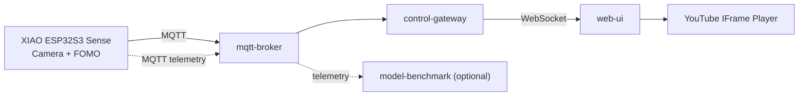

# smart-youtube-face-control

> ⚠️ **Skeleton Repository — 실제 기능 코드는 아직 구현되지 않았습니다.**
> 현재는 Repository 구조, Docker Container 골격, 통신 Contract(JSON Schema), 설계 문서 템플릿만 포함합니다.

## Project Overview

Seeed Studio **XIAO ESP32S3 Sense**의 카메라와 **Edge Impulse Face Detection (FOMO)** 모델을 사용하여

- 사용자가 화면을 **정면으로 보고 있을 때** → YouTube 영상 **재생 (PLAY)**
- 얼굴이 검출되지 않거나 **측면/뒤쪽**을 바라볼 때 → 영상 **일시정지 (PAUSE)**

하는 실시간 스마트 미디어 제어 시스템입니다.

## System Architecture



자세한 내용: [`docs/architecture.md`](docs/architecture.md)

## Repository Structure

```
smart-youtube-face-control/
├── README.md
├── .gitignore
├── .env.example
├── docker-compose.yml
├── firmware/xiao-esp32s3-sense/   # Arduino firmware (not a container)
│   ├── include/  src/  models/  config/
├── services/
│   ├── mqtt-broker/               # Eclipse Mosquitto
│   ├── control-gateway/           # MQTT → State Machine → WebSocket
│   ├── web-ui/                    # YouTube IFrame API frontend
│   └── model-benchmark/           # Optional (profile: benchmark)
├── contracts/
│   ├── mqtt/                      # detection / status / telemetry schema
│   └── websocket/                 # media-control schema
├── docs/                          # architecture, communication, benchmark, test plan, roles
└── scripts/
```

## Docker Services

| Service | Base Image | Port | Profile | 상태 |
|---------|-----------|------|---------|------|
| `mqtt-broker` | `eclipse-mosquitto:2.0.18` | 1883 (9001 reserved) | default | 설정 파일만 존재 |
| `control-gateway` | `python:3.12-slim` (placeholder) | 8000 | default | placeholder (sleep) |
| `web-ui` | `nginx:1.27-alpine` | 8080 → 80 | default | 빈 static 서빙 |
| `model-benchmark` | `python:3.12-slim` (placeholder) | – | `benchmark` | placeholder (sleep) |

- Network: `smart-media-network`
- XIAO ESP32S3 Sense Firmware는 Docker Container가 아닙니다.

## Communication Flow

1. XIAO ESP32S3 Sense → Camera Capture → Edge Impulse FOMO Face Detection
2. Front Face / Face Absent 상태 판단
3. MQTT publish → `smart-media/{device_id}/detection`
4. Mosquitto Broker → Control Gateway (subscribe)
5. Control Gateway → WebSocket `media_control` (`PLAY` / `PAUSE`)
6. Web UI → YouTube IFrame API → PLAY / PAUSE

| Channel | Topic / Endpoint | Schema |
|---------|------------------|--------|
| MQTT | `smart-media/{device_id}/detection` | [`contracts/mqtt/detection.schema.json`](contracts/mqtt/detection.schema.json) |
| MQTT | `smart-media/{device_id}/status` | [`contracts/mqtt/status.schema.json`](contracts/mqtt/status.schema.json) |
| MQTT | `smart-media/{device_id}/telemetry` | [`contracts/mqtt/telemetry.schema.json`](contracts/mqtt/telemetry.schema.json) |
| WebSocket | Gateway → Browser | [`contracts/websocket/media-control.schema.json`](contracts/websocket/media-control.schema.json) |

자세한 내용: [`docs/communication.md`](docs/communication.md)

## Team Roles

| Member | 역할 | 시작 디렉터리 |
|--------|------|---------------|
| A | Embedded / AI | `firmware/xiao-esp32s3-sense/` |
| B | Backend / IoT | `services/mqtt-broker/`, `services/control-gateway/` |
| C | Frontend | `services/web-ui/` |
| D | Benchmark / Integration | `services/model-benchmark/`, `docker-compose.yml`, `docs/` |

자세한 내용: [`docs/roles.md`](docs/roles.md)

## How to start Docker skeleton

```bash
# 1. 환경 변수 파일 생성 (선택)
cp .env.example .env

# 2. Runtime skeleton 실행 (mqtt-broker, control-gateway, web-ui)
docker compose up -d --build

# 3. Benchmark 포함 실행 (optional)
docker compose --profile benchmark up -d --build

# 4. 상태 확인 / 종료
docker compose ps
docker compose down
```

> control-gateway / model-benchmark는 애플리케이션 코드 없이 `sleep`으로 유지되는 placeholder Container입니다.

## Future Implementation

- [ ] Firmware: Camera capture, Edge Impulse inference, MQTT publisher (Member A)
- [ ] Control Gateway: MQTT subscriber, State Machine, WebSocket server (Member B) — Python FastAPI 또는 Node.js
- [ ] Web UI: YouTube IFrame API 연동, PLAY/PAUSE 제어, Face Status UI (Member C)
- [ ] Model Benchmark: 모델 비교 및 성능 측정 (Member D)
- [ ] Integration Test 및 MQTT 인증/보안 설정
