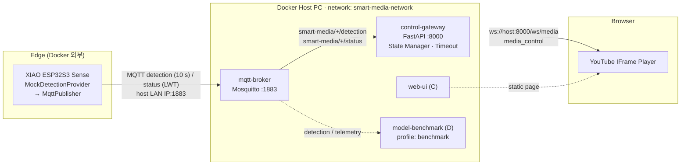
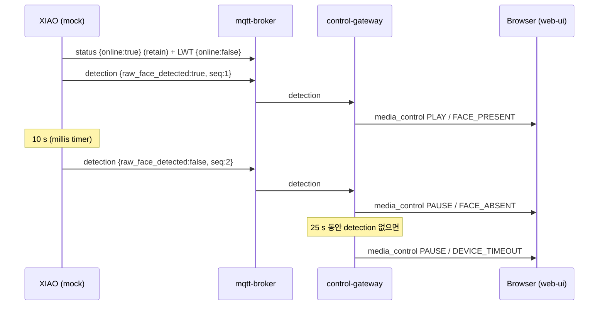

# Architecture

> 현재 버전: **A/B Mock Demo** — Firmware(Mock Detection), MQTT Broker, Control Gateway 구현 완료.
> Web UI(C), Model Benchmark(D)는 각 담당자가 개발 중이며 이 문서는 해당 서비스의 인터페이스만 기술합니다.

## 1. 개요

XIAO ESP32S3 Sense가 얼굴 존재 여부(`raw_face_detected`)를 MQTT로 발행하면, Control Gateway가 이를 PLAY/PAUSE 명령으로 바꿔 WebSocket으로 Web UI에 전달하고, Web UI가 YouTube IFrame API로 영상을 제어합니다.

이번 버전은 **얼굴 존재 여부만** 판단합니다 (정면/측면/후면 구분 없음). Firmware는 실제 모델 대신 Mock Provider가 10초마다 `true/false`를 번갈아 생성합니다.

## 2. 구성 및 담당

| Part | Component | 위치 | Runtime | 상태 |
|------|-----------|------|---------|------|
| A | Firmware (Mock Detection → MQTT) | `firmware/xiao-esp32s3-sense/smart_media/` | XIAO ESP32S3 (Arduino) | 구현, 컴파일 검증 (실기기 미검증) |
| B | mqtt-broker (Mosquitto 2) | `services/mqtt-broker/` | Docker | 구현, 검증 |
| B | control-gateway (FastAPI) | `services/control-gateway/` | Docker | 구현, 검증 |
| C | web-ui (YouTube IFrame API) | `services/web-ui/` | Docker → Browser | C 담당 (skeleton) |
| D | model-benchmark | `services/model-benchmark/` | Docker (profile `benchmark`) | D 담당 (skeleton) |

## 3. 데이터 흐름

## 4. MQTT Broker와 Gateway를 분리한 이유

- **책임 분리**: Broker는 메시지 라우팅만, Gateway는 상태 판단/WebSocket만 담당. 한쪽 재시작이 다른 쪽 코드에 영향 없음.
- **다중 소비자**: 같은 Broker를 D의 model-benchmark, 디버깅용 `mosquitto_sub` 등이 동시에 구독할 수 있음.
- **장애 격리 / Fail-safe**: Broker가 재시작되면 Gateway는 연결 끊김을 감지해 즉시 PAUSE(`BROKER_DISCONNECTED`)하고 자동 재연결 (T09에서 검증).
- **표준 프로토콜**: ESP32는 가벼운 MQTT만 알면 되고, 브라우저는 WebSocket만 알면 됨.

## 5. Docker Network

| Service | Container 내부 주소 | Host 노출 포트 |
|---------|---------------------|----------------|
| mqtt-broker | `mqtt-broker:1883` | `1883` |
| control-gateway | `control-gateway:8000` | `8000` |
| web-ui | `web-ui:80` | `8080` |
| model-benchmark | – | – |

- Network 이름: `smart-media-network` (bridge)
- Gateway → Broker: Docker DNS `mqtt-broker:1883`
- ESP32 → Broker: **Host PC의 LAN IP:1883** (Docker 내부 이름 사용 불가)
- Browser → Gateway: `ws://<host>:8000/ws/media`

## 6. 병목 분석

- **Primary runtime bottleneck은 Container가 아니라 XIAO ESP32S3 Sense의 Camera preprocessing 및 Edge ML inference가 될 가능성이 높습니다.** (실제 모델 연동 후 측정 필요)
- MQTT Broker, Gateway, WebSocket은 메시지가 수백 byte JSON이라 병목 가능성이 낮습니다.
  로컬 검증에서 MQTT publish → WebSocket 수신이 수 ms 이내였습니다 (`docs/demo-test.md`).
- 현재 Mock 데모에서 체감 반응 시간을 지배하는 것은 **10초 발행 주기**입니다 (최대 10초 지연).
- Wi-Fi 품질, PC 방화벽(1883 인바운드)이 실기기 연결의 주요 위험 요소입니다.
