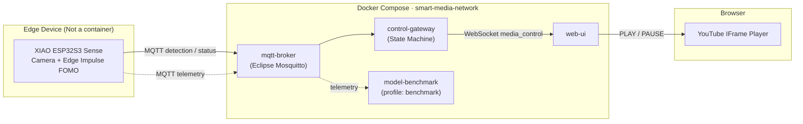
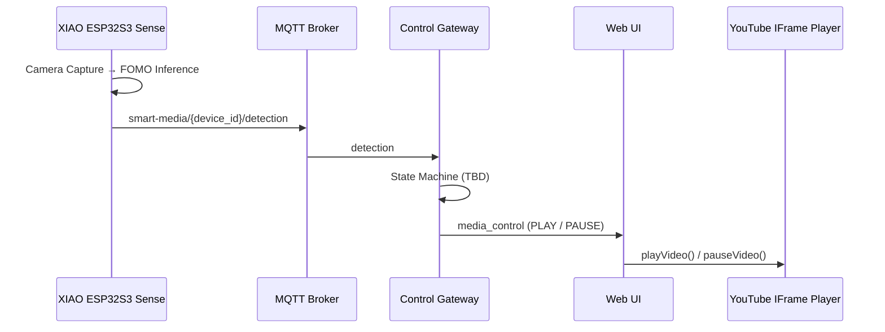

# Architecture

> ⚠️ 설계 문서 템플릿입니다. 실제 구현은 아직 존재하지 않습니다.

## 1. 개요

XIAO ESP32S3 Sense가 카메라 영상에서 Edge Impulse FOMO Face Detection으로 얼굴을 검출하고, 결과를 MQTT로 전송합니다.
Control Gateway는 이를 받아 PLAY / PAUSE 명령으로 변환한 뒤 WebSocket으로 Web UI에 전달하며, Web UI는 YouTube IFrame API로 영상을 제어합니다.

## 2. 데이터 흐름

## 3. 구성 요소

| Component | 위치 | Runtime | 책임 |
|-----------|------|---------|------|
| XIAO ESP32S3 Sense Firmware | `firmware/xiao-esp32s3-sense/` | MCU (Arduino) | Camera capture, preprocessing, inference, MQTT publish |
| mqtt-broker | `services/mqtt-broker/` | Docker | MQTT message routing |
| control-gateway | `services/control-gateway/` | Docker | MQTT subscribe, state machine, WebSocket push |
| web-ui | `services/web-ui/` | Docker → Browser | YouTube IFrame API 제어, 얼굴 상태 표시 |
| model-benchmark | `services/model-benchmark/` | Docker (optional) | 모델 성능 측정 및 결과 저장 |

## 4. 병목 분석 (예상)

- **Primary runtime bottleneck은 Container가 아니라 XIAO ESP32S3 Sense의 Camera preprocessing 및 Edge ML inference가 될 가능성이 높습니다.**
  - 카메라 캡처, 이미지 리사이즈/포맷 변환, FOMO 추론이 MCU 단일 디바이스에서 순차적으로 수행됩니다.
  - 추론 시간(`inference_ms`)이 수백 ms 수준일 경우 전체 PLAY/PAUSE 반응 시간의 대부분을 차지합니다.
- **MQTT Broker, Gateway, WebSocket은 메시지 크기가 매우 작기 때문에 (수백 byte JSON) 병목 가능성이 낮습니다.**
  - 단, Wi-Fi 품질(RSSI) 및 Gateway의 상태 전환 debounce 정책은 체감 지연에 영향을 줄 수 있습니다.

## 5. 미결정 사항 (TBD)

- [ ] Control Gateway 구현 언어 (Python FastAPI vs Node.js)
- [ ] Front Face / Face Absent 판단 알고리즘 (threshold, debounce, hysteresis)
- [ ] Device timeout 정책
- [ ] Web UI 프레임워크 (React/Vite 등)
- [ ] 보안 (MQTT 인증, TLS)
